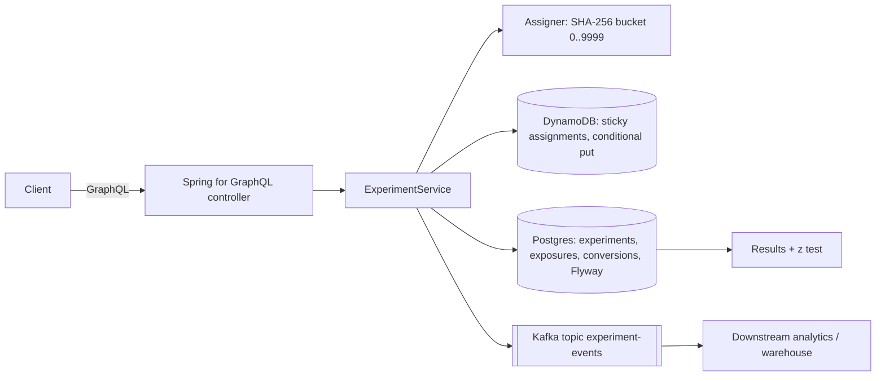

# kotlin-growth-experiments-service

A Kotlin + Spring Boot service for running **A/B experiments**: a **GraphQL API** to define, start and stop experiments, **deterministic hash based assignment** with traffic ramping, **sticky assignments in DynamoDB**, exposures and conversions in **Postgres**, **Kafka events** for downstream analytics, and a built in two proportion z test for results. Integration tests run against real Postgres, Kafka and DynamoDB Local with **Testcontainers**.

> Portfolio demo. Runs fully locally (DynamoDB Local, no AWS account). Not used in production.

## Problem

Growth teams need experiment assignment that is:

- **Deterministic and stateless**: the same user gets the same variant from any instance, with no lookup on the hot path.
- **Sticky**: once a user has seen a variant, later weight changes must not move them (that would contaminate results).
- **Rampable**: going from 10% to 50% traffic keeps the original 10% in their variants.
- **Measurable**: exposures and conversions are counted per unique user, and events stream to the analytics pipeline.

## Architecture



Assignment flow: hash `salt:key:traffic:user` to decide inclusion, hash `salt:key:user` to pick a variant by cumulative weight, then a DynamoDB conditional put (`attribute_not_exists`) records the first variant. If the item already exists, the stored variant wins. A first exposure inserts into Postgres and publishes an `exposure` event keyed by user id.

## Run it

```bash
docker compose up --build
# GraphiQL at http://localhost:8080/graphiql
```

```graphql
mutation {
  createExperiment(key: "checkout-cta", description: "Buy now vs Checkout",
    variants: [{name: "control", weight: 50}, {name: "buy-now", weight: 50}], trafficPercent: 20) { key status }
}
mutation { startExperiment(key: "checkout-cta") { status } }
mutation { assign(key: "checkout-cta", userId: "user-42") { variant firstExposure } }
mutation { trackConversion(key: "checkout-cta", userId: "user-42", metric: "purchase") }
query {
  results(key: "checkout-cta", metric: "purchase") {
    variants { variant exposures conversions rate }
    comparisons { control treatment absoluteLift pValue significant }
  }
}
```

## Tests

```bash
./gradlew test   # needs Docker for Testcontainers
```

- **AssignerTest:** determinism, weight split within 2 points over 20,000 users, traffic ramp keeps included users in the same variant, independence across salts, validation.
- **StatsTest:** normal CDF reference values, significant vs noise lifts, empty arms.
- **ExperimentFlowIT (Testcontainers: Postgres 16, Confluent Kafka, DynamoDB Local):** full GraphQL flow from create to results, no assignment before start, sticky re-assignment, duplicate and unexposed conversions ignored, exact exposure and conversion counts, and 40 exposure plus 10 conversion events read back from Kafka. Also checks GraphQL error mapping.

CI runs the whole suite on GitHub Actions and builds the Docker image.

## Design decisions

- **Hashing instead of random + store** keeps assignment O(1) and identical across instances; storage is only for stickiness and auditing.
- **Separate hashes for traffic and variant** so ramping traffic does not reshuffle variants.
- **DynamoDB for the assignment log** (key value, high write rate, conditional writes), **Postgres for definitions and metrics** (relational queries, constraints, Flyway migrations).
- **Unique exposure and conversion per user** enforced by primary keys, with conversions only accepted for exposed users (foreign key).
- **Kafka events keyed by user** keep per user ordering and an idempotent producer (`acks=all`).
- **Stats in the service** are a convenience readout; serious analysis would happen in the warehouse with sequential testing or CUPED.

## Limitations

- The Postgres write and the Kafka publish are not atomic; a transactional outbox would fix that.
- No auth, no experiment mutual exclusion layers, no holdouts.
- Fixed horizon z test only; peeking at results inflates false positives.
- Single metric per results query.

## License

MIT
